# Transition Mesh V1.0 有限元过渡网格生成插件

Abaqus/CAE 二维与三维参数化过渡网格插件。支持 2:1 与 3:1 过渡、五种几何模式、多层级联、混合过渡与全域自动划分。

[English](README.md) | **简体中文**

> 本项目借助 AI 辅助编程（vibecoding）完成。
>
> 非商业用途可直接使用；商用请先联系作者。
>
> 问题反馈：欢迎提交 [GitHub Issue](https://github.com/IY724/TransitionMesh/issues)，或发送邮件至 **Z25150070@s.upc.edu.cn**。

## 目录

1. [插件介绍](#1-插件介绍)
2. [安装与运行环境](#2-安装与运行环境)
3. [界面与通用参数](#3-界面与通用参数)
4. [分模式操作](#4-分模式操作)
5. [常见报错与处理](#5-常见报错与处理)
6. [使用范围与限制](#6-使用范围与限制)
7. [联系与支持](#7-联系与支持)

## 1 插件介绍

### 1.1 功能概述

Transition Mesh 是一款运行在 Abaqus/CAE 中的前处理插件，用来在细网格区与粗网格区之间自动生成过渡网格。手工完成这件事，通常需要反复切分几何、逐条边布种，再检查两侧节点是否一一对应。插件把这一过程整理成固定模板：在过渡带内铺设 2:1 或 3:1 的四边形或六面体单元，细侧 N 段对应粗侧的 N/2 或 N/3 段，交界面节点一一对应，过渡带内不产生悬挂节点和三角形。

插件支持二维面和三维实体。三维模式要求过渡带位于已经切分好的实体 Cell 上，并且该 Cell 具备可用的扫掠或结构化划分条件。

<table>
<tr>
<td align="center" width="58%">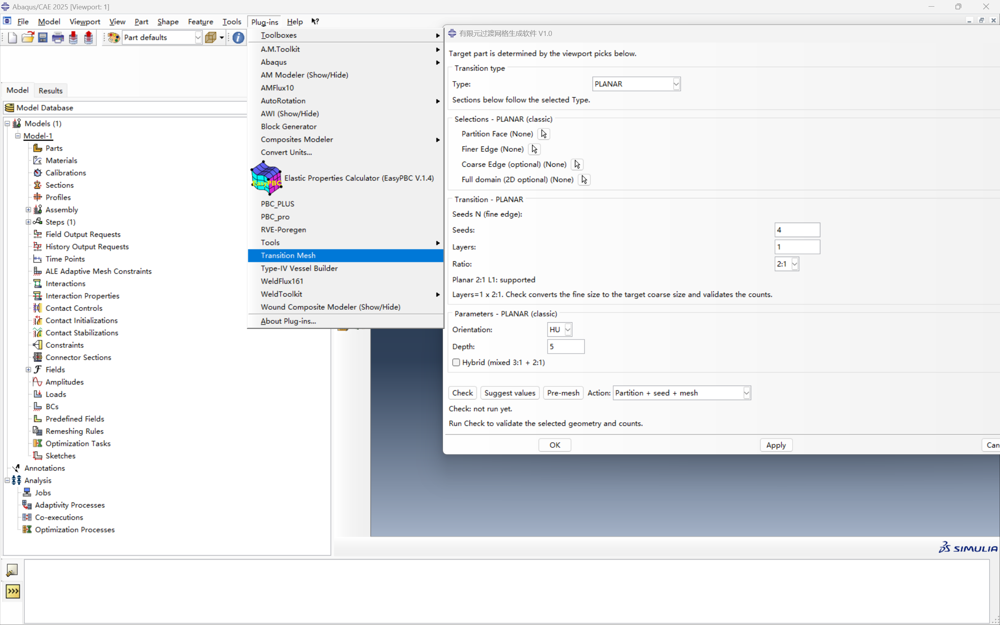<br/>Plug-ins 菜单入口与参数对话框</td>
<td align="center" width="42%">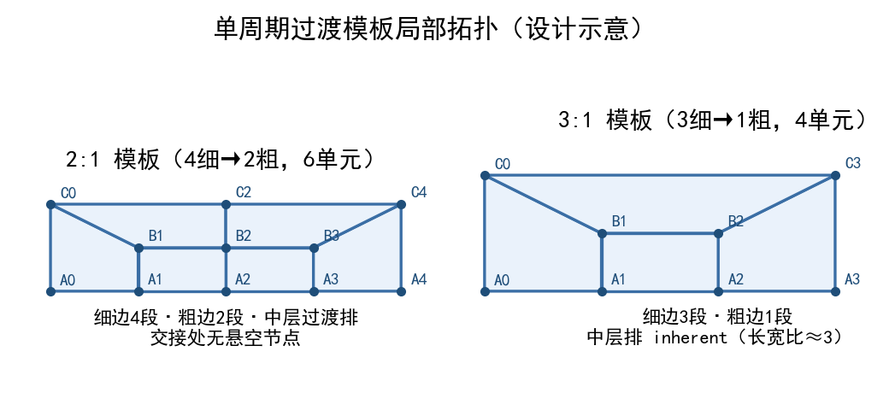<br/>2:1 与 3:1 单周期模板（设计示意）</td>
</tr>
</table>

### 1.2 五种过渡模式

| 模式代码 | 适用几何 | 过渡比 | 过渡方向 | 多层支持 |
| --- | --- | --- | --- | --- |
| `PLANAR` | 直边过渡带，二维面或三维平板的源面 | 2:1、3:1、混合 | `Orientation` 指定上、下、左、右 | 支持多层；混合仅单层 |
| `PLANAR_ANNULAR` | 平面同心圆环 | 2:1、3:1 | 细端在内或在外 | 支持多层 |
| `PLANAR_QUAD_FOUR` | 矩形内框向外一圈或多圈 | 2:1、3:1 | 细内粗外 | 2:1 支持多层；3:1 建议单层 |
| `ANNULAR_RADIAL` | 圆筒端面沿半径方向的环带 | 2:1、3:1 | 细端在内或在外 | 支持多层，须按中间半径预切实体 |
| `AXIAL_SURFACE` | 圆筒柱面沿轴线方向 | 2:1、3:1 | 细圈到粗圈 | 支持多层，软件自动切分中间截面 |

模式的选择取决于过渡区域的几何形态：

- 直边带状区域：选 `PLANAR`；
- 平面同心环带：选 `PLANAR_ANNULAR`；
- 矩形内框向外扩整圈：选 `PLANAR_QUAD_FOUR`；
- 圆筒端面沿半径的环带：选 `ANNULAR_RADIAL`；
- 圆筒柱面沿轴线的条带：选 `AXIAL_SURFACE`。

如果同一几何存在多种可行方案，例如带孔平板的孔周，可以按内孔形状和已有分区选择圆环模式或四周模式。

### 1.3 工作流程

插件采用“拾取、校验、试划、执行”的流程：

1. **拾取几何**：选择模式，按提示在视口中点选目标面和基准边，每项按 Done 确认；
2. **设置参数**：填写细侧段数 `Seeds`、过渡层数 `Layers` 和过渡比 `Ratio`；
3. **Check**：只读校验输入、整除性和几何计划，FAIL 会阻止执行；
4. **Pre-mesh**：在模型事务中真实试划一次并做质量审计，随后自动回滚，原模型不变；
5. **Apply**：在 `Action` 中选择执行档位，正式执行。

`Check` 通过说明计划成立，`Pre-mesh` 通过说明该组合可以交付。修改任何输入后，旧的检查结论会失效，状态行会提示 `Check is stale`，需要重新检查。

执行过程受模型事务保护。任何一步硬失败都会整体回滚，模型恢复到执行前状态，不会留下半截分区或半截种子。

`Action` 有两档：

- `Partition + seed only (no mesh)`：只做几何分区和局部布种，保留给你自己调整网格控制或二次划分；
- `Partition + seed + mesh`：完成分区、布种并直接生成网格。

二维模式还可以拾取 `Full domain`，把过渡带和相连的规则区域一次性划分。

## 2 安装与运行环境

### 2.1 环境要求

- Abaqus/CAE 2024 或更高版本，已在 Abaqus/CAE 2025 上验证；
- Windows 系统；
- 插件为纯 Python 实现，由 Abaqus 内置解释器加载，不需要额外安装第三方库。

### 2.2 安装步骤

1. 关闭所有 Abaqus/CAE 窗口；
2. 从 [Releases](https://github.com/IY724/TransitionMesh/releases/latest) 下载最新插件包，解压；
3. 把整个 `TransitionMesh` 文件夹复制到 Abaqus 的插件搜索目录。13 个脚本全部直接放在这个文件夹内，不要再拆分到上级目录，也不要再套一层 `TransitionMesh` 子目录。常见位置是 `%USERPROFILE%\abaqus_plugins`；如果你通过 `plugin_path` 或快捷方式参数指定了其他目录，就放到那个目录；
4. 启动 Abaqus/CAE，在 `Plug-ins` 菜单中确认出现 `Transition Mesh`；
5. 打开一次对话框，确认底部状态行和参数区显示正常。

安装后的目录结构应为：

```text
<Abaqus 插件搜索目录>/
└─ TransitionMesh/
   ├─ transitionMesh_plugin.py
   ├─ transitionMeshDB.py
   ├─ transition_mesh_gui_kernel.py
   ├─ transition_mesh_plan.py
   ├─ transition_mesh_rules.py
   ├─ transition_mesh_runtime.py
   ├─ transition_mesh_regions.py
   ├─ transition_mesh_corner_templates.py
   ├─ transition_mesh_plugin.py
   ├─ transition_mesh_quad2.py
   ├─ transition_mesh_quad2_cae.py
   ├─ transition_mesh_plugin_planar2d.py
   └─ transition_mesh_plugin_cylinder_kernel.py
```

注意：目录名必须保持 `TransitionMesh`，13 个脚本直接放在该目录内。同一个插件搜索目录中只保留一份完整副本，不要同时放旧版、备份副本或其他改名的副本。若菜单没有出现，或加载时提示版本冲突，先清理重复副本再重启 CAE。

### 2.3 插件组成

插件由 13 个 Python 模块组成，按界面、调度、规则、内核和运行支持分层：

| 功能层 | 模块 | 职责 |
| --- | --- | --- |
| 界面层 | `TransitionMesh/transitionMesh_plugin.py` | 注册插件菜单与表单，收集关键字，执行输入前置校验 |
| 界面层 | `TransitionMesh/transitionMeshDB.py` | 参数对话框与拾取处理器，Check 结果轮询弹窗，参数联动 |
| 调度层 | `TransitionMesh/transition_mesh_gui_kernel.py` | 模式路由，Check 与 Pre-mesh 调度，执行审计 |
| 规则层 | `TransitionMesh/transition_mesh_rules.py` | 模式能力表，混排拆分，整除校验，角度适配 |
| 规则层 | `TransitionMesh/transition_mesh_plan.py` | 计数链规划，级宽分配，建议值搜索 |
| 内核层 | `TransitionMesh/transition_mesh_plugin.py` | 经典平面模板、草图绘制、分区与布种基础函数 |
| 内核层 | `TransitionMesh/transition_mesh_plugin_planar2d.py` | 平面圆环与矩形四周的规划、分区、布种与划网 |
| 内核层 | `TransitionMesh/transition_mesh_quad2.py` | 四周 2:1 参考拓扑的计数链与拓扑构建 |
| 内核层 | `TransitionMesh/transition_mesh_quad2_cae.py` | 四周 2:1 参考拓扑的规划、分区、布种、划网与核对 |
| 内核层 | `TransitionMesh/transition_mesh_corner_templates.py` | 角部模板构建与校验，多级矩形环审计 |
| 内核层 | `TransitionMesh/transition_mesh_plugin_cylinder_kernel.py` | 圆筒径向与轴向的坐标框架、模板印迹、布种与逐块划网 |
| 运行支持层 | `TransitionMesh/transition_mesh_runtime.py` | 模型事务，过程日志，结果发布 |
| 运行支持层 | `TransitionMesh/transition_mesh_regions.py` | 区域签名与校验，批量区域重定位 |

## 3 界面与通用参数

### 3.1 对话框结构

对话框自上而下分为五个区：

1. **模式选择区**：`Type` 下拉框切换五种模式；
2. **几何拾取组**：随模式联动，显示当前模式需要的面、边、Cell 和路径；
3. **通用参数组**：`Seeds`、`Layers`、`Ratio`，四周模式额外显示 `Ny`；
4. **模式专属参数组**：经典平面显示 `Orientation`、`Depth`、`Hybrid`，圆筒模式显示 `Auto-adapt`；
5. **底部执行区**：`Check`、`Suggest values`、`Pre-mesh`、`Action`、`Apply`、`Cancel`，以及状态行。

切换 `Type` 时，不相关的拾取项和参数会自动隐藏。拾取完成后按 Done 确认，拾取行会显示当前已选数量。

### 3.2 通用参数

| 参数 | 作用 | 说明 |
| --- | --- | --- |
| `Seeds` | 细侧段数 | 直边模式是细边段数；圆环和圆筒模式是一圈的段数；四周模式是主向段数 `Nx`；轴向模式是每个截面的圆周段数 |
| `Layers` | 过渡层数 | 1 表示单层；大于 1 表示多层级联 |
| `Ratio` | 过渡比 | 支持 2:1 与 3:1 |
| `Orientation` | 过渡方向 | 仅经典平面模式，取值为 `HU`、`HD`、`VR`、`VL` |
| `Depth` | 过渡带宽度 | 未拾取粗边时由它决定带宽；拾取粗边后按实测距离计算 |
| `Ny` | 正交向细段数 | 仅四周模式，`0` 表示与 `Nx` 相同 |
| `Hybrid` | 混合过渡开关 | 仅经典平面模式，单层，2:1 与 3:1 混排 |
| `2:1 blocks b` | 2:1 组数 | 仅混合模式，`b` 必须为偶数 |
| `Auto-adapt` | 相邻规则区自动适配 | 仅圆筒模式，自动为相邻规则区布种并划网 |
| `Action` | 执行档位 | 只分区布种，或分区布种并划网 |

### 3.3 过渡比与整除关系

设细侧段数为 `N`，过渡比为 `r`，层数为 `L`，则粗侧段数为：

```text
粗侧段数 = N / (r ^ L)
```

因此：

- 2:1 时，`N` 必须能被 `2^L` 整除；
- 3:1 时，`N` 必须能被 `3^L` 整除。

例如：

```text
2:1，N=40，L=1  ->  粗侧 20 段
2:1，N=40，L=2  ->  粗侧 10 段
3:1，N=36，L=1  ->  粗侧 12 段
3:1，N=36，L=2  ->  粗侧 4 段
```

`N` 应取细边长度除以目标细单元尺寸。例如细边长 40 mm，希望细单元约 1 mm，则 `N=40`。

四周模式的粗侧段数还要加上两个角部的贡献，计算公式见 4.3.2 节。

### 3.4 方向

经典平面模式的 `Orientation` 按模型全局坐标解释，不随视口旋转：

| 选项 | 含义 |
| --- | --- |
| `HU` | 细边在上，过渡带向下延伸 |
| `HD` | 细边在下，过渡带向上延伸 |
| `VL` | 细边在左，过渡带向右延伸 |
| `VR` | 细边在右，过渡带向左延伸 |

如果细边是内部切割边，方向必须指向当前选中的面。例如选中上半面和中间切割边时，应使用 `HD` 向上过渡；选中下半面和中间切割边时，应使用 `HU` 向下过渡。方向指向面外时，插件会直接报错，不会自动换到另一侧。

### 3.5 Check、Suggest values 与 Pre-mesh

- **Check**：只读校验。检查拾取是否完整、段数是否整除、模板周期是否成立、几何尺寸是否相容。通过时状态行显示 `Check PASS`，失败时显示原因和修正建议。
- **Suggest values**：先跑一次 Check。如果当前参数不合法，自动回填一组邻近的合法值；如果已经合法，会提示无需修改。
- **Pre-mesh**：在隔离的模型事务中执行一次真实的分区、布种和划网，检查单元数量、悬挂节点、三角形和雅可比等质量项，随后自动回滚。通过时显示 `Pre-mesh PASS`，失败时给出具体原因，模型保持原样。
- **Apply**：正式执行。建议先通过 Check 和 Pre-mesh，再执行 Apply，结果与试划一致。

## 4 分模式操作

### 4.1 PLANAR 经典平面

适用几何：直边过渡带，二维面或三维平板的源面。

#### 4.1.1 拾取项

| 拾取项 | 是否必选 | 说明 |
| --- | --- | --- |
| `Partition Face` | 必选，单选 | 要画过渡网格的面 |
| `Finer Edge` | 必选，单选 | 细网格所在的边 |
| `Coarse Edge` | 可选，单选 | 粗网格所在的边；不选时由 `Depth` 决定带宽 |
| `Full domain` | 可选，单选 | 二维模式下要一并划分的规则区域；不选时只处理过渡带 |

三维平板仍然使用 `PLANAR`。过渡块必须是可扫掠的实体 Cell，需要你预先切分几何，并在 Mesh 模块为过渡块指定 Sweep 和扫掠方向，然后在源面上执行过渡划分。

#### 4.1.2 操作步骤

1. 打开零件，进入 Mesh 模块，先为主体区域设置全局种子。全局种子应代表主体希望保留的粗网格尺寸，不要设成细边的最小尺寸；
2. 打开 `Plug-ins -> Transition Mesh`，`Type` 选择 `PLANAR`；
3. 拾取 `Partition Face`，按 Done 确认；
4. 拾取 `Finer Edge`，按 Done 确认；
5. 按需拾取 `Coarse Edge`。如果不选，插件按 `Depth` 自动计算带宽；
6. 按需拾取 `Full domain`。如果不选，只划分过渡带；
7. 在 `Seeds` 填细边段数，在 `Layers` 填层数，在 `Ratio` 选择 2:1 或 3:1；
8. 在 `Orientation` 选择方向，在 `Depth` 填写带宽。如果已经拾取粗边，`Depth` 可以随意填写，插件会按实测距离计算；
9. 点击 `Check`，必要时点击 `Suggest values`；
10. 点击 `Pre-mesh` 试划并检查质量；
11. 在 `Action` 选择执行档位，点击 `Apply` 或 `OK`。

<table>
<tr>
<td align="center" width="50%">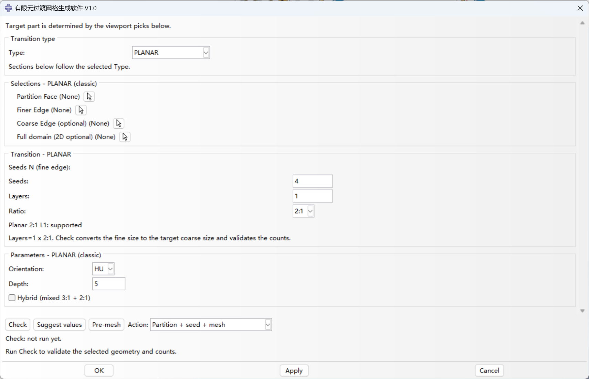<br/>PLANAR 模式对话框</td>
<td align="center" width="50%">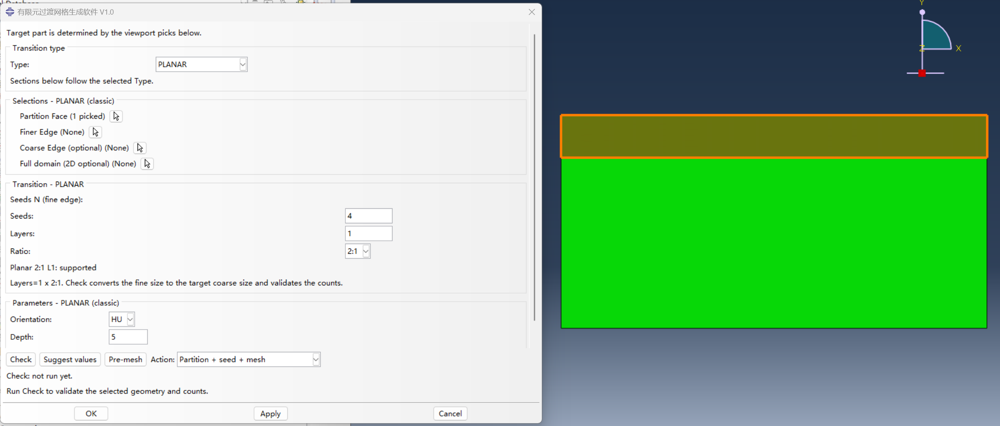<br/>拾取过渡面 Partition Face</td>
</tr>
<tr>
<td align="center" width="50%">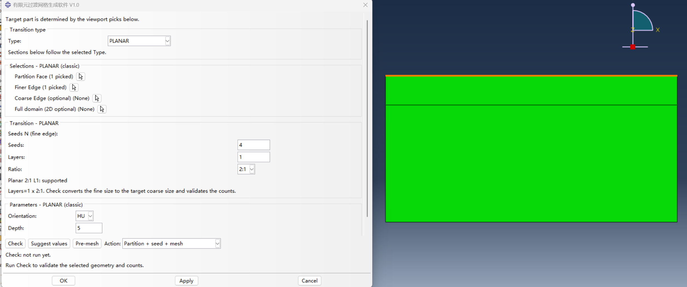<br/>拾取细边 Finer Edge</td>
<td align="center" width="50%">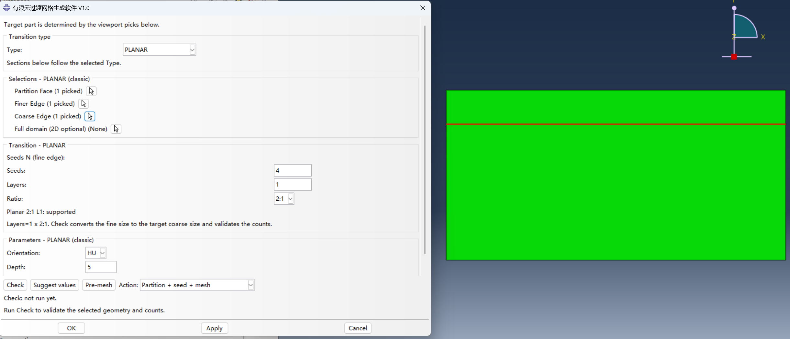<br/>拾取粗边 Coarse Edge（可留空）</td>
</tr>
<tr>
<td align="center" width="50%">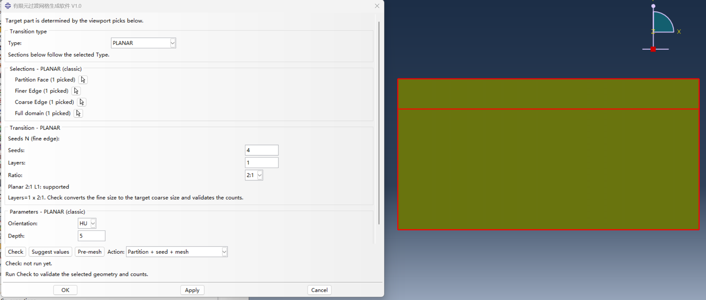<br/>拾取全域 Full domain（可留空）</td>
<td align="center" width="50%">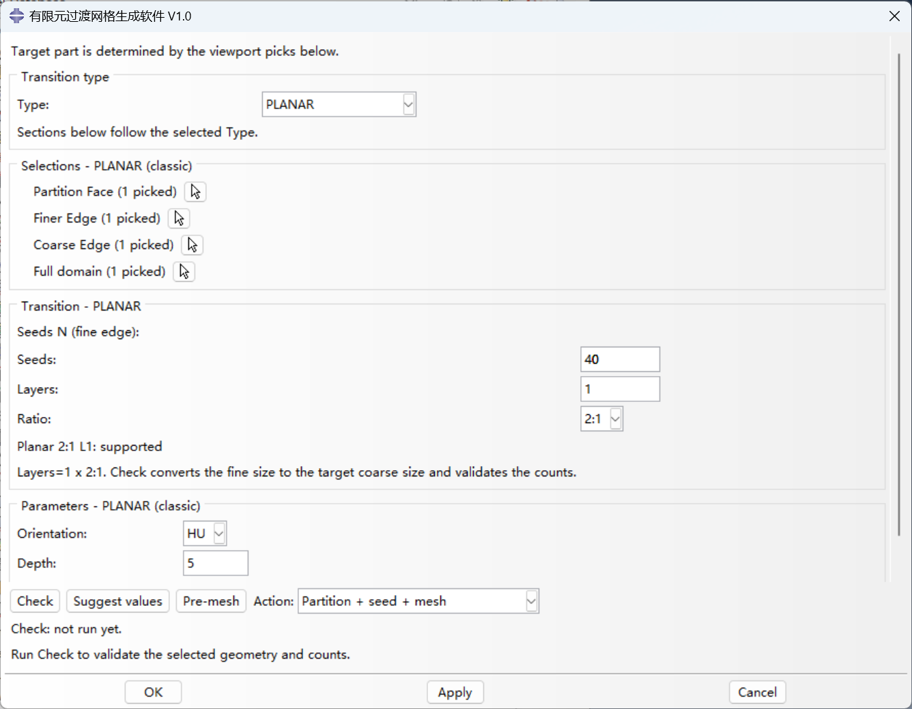<br/>设置 Seeds、Layers 与 Ratio</td>
</tr>
<tr>
<td align="center" width="50%">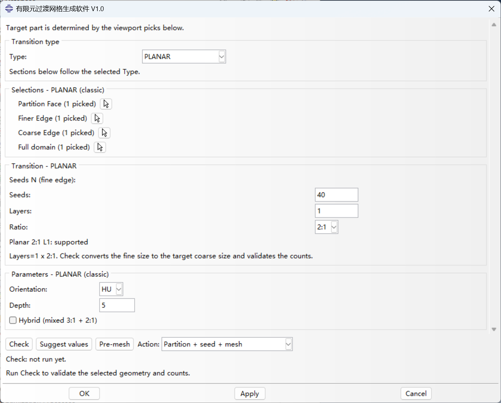<br/>设置 Orientation、Depth 与 Hybrid</td>
<td align="center" width="50%">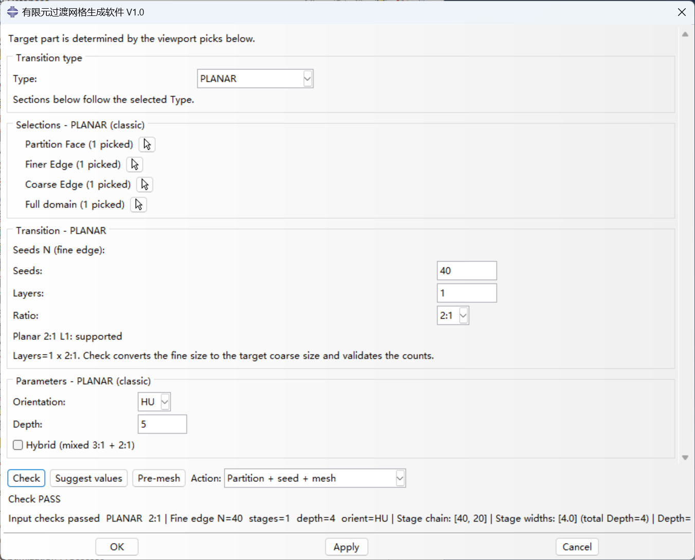<br/>Check 通过后的状态行</td>
</tr>
</table>

#### 4.1.3 执行结果

<table>
<tr>
<td align="center" width="50%">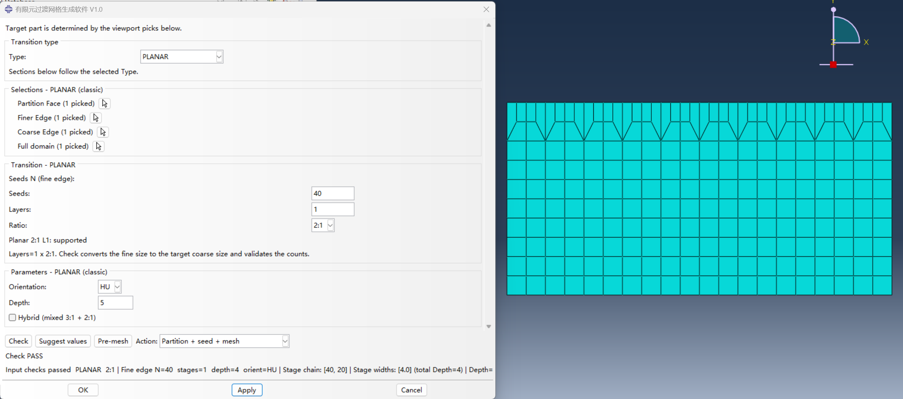<br/>2:1 全域自动划分结果</td>
<td align="center" width="50%">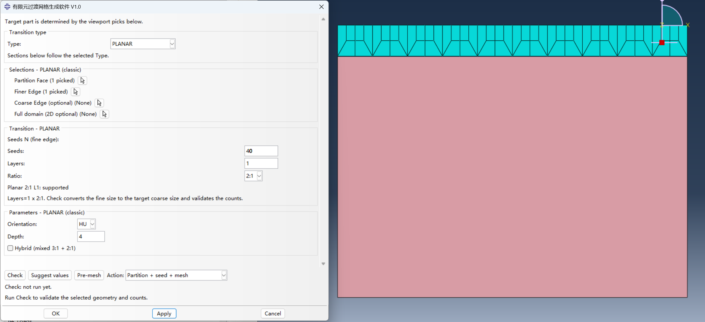<br/>只划分过渡带</td>
</tr>
<tr>
<td align="center" width="50%">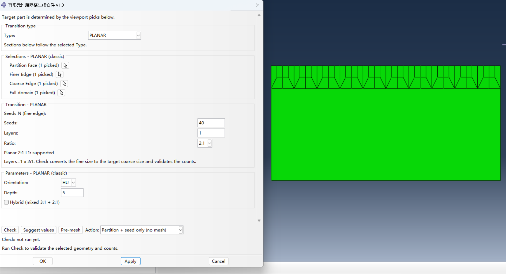<br/>Action 选择只分区布种</td>
<td align="center" width="50%">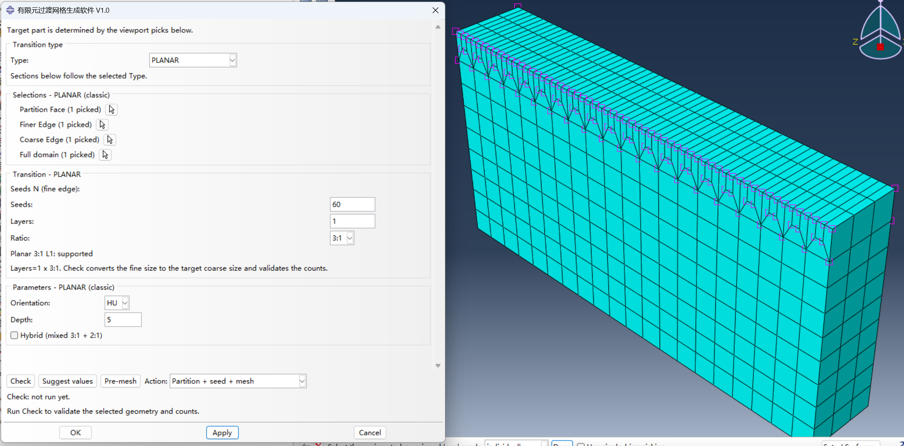<br/>三维平板 3:1 过渡</td>
</tr>
</table>

如果不想让插件生成最终网格，只希望保留分区和局部种子，把 `Action` 切换为 `Partition + seed only (no mesh)`。插件会保留你已有的全局种子，只对过渡带内的短边设置局部固定种子，避免主体区域被细尺寸拖成过密网格。

#### 4.1.4 多层过渡

`Layers` 大于 1 时，插件按级联过渡自动分配每级带宽。多层建议配合较大的 `Depth` 使用，过渡区太窄而层数太多时，单元会被压得很扁，甚至无法划分。

操作上与单层相同，可以不拾取粗边，只指定细边、方向和 `Depth`，由插件按层数自动向外铺开。

<table>
<tr>
<td align="center" width="50%">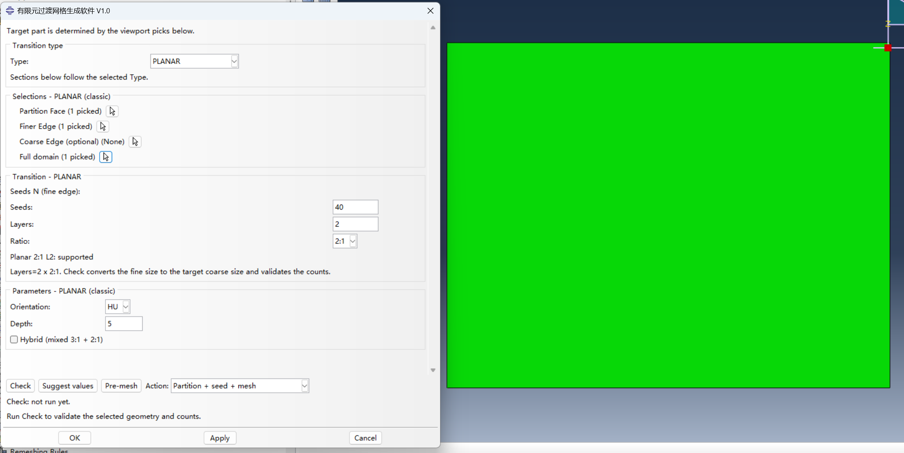<br/>两层过渡：拾取与参数（应用前）</td>
<td align="center" width="50%">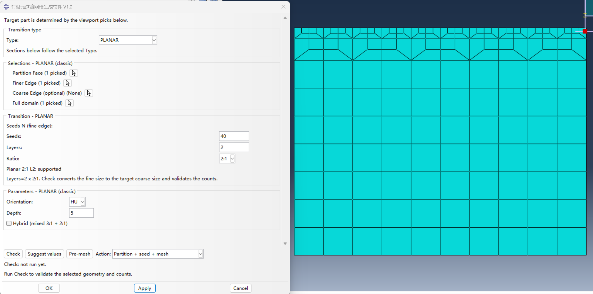<br/>两层 2:1 过渡结果</td>
</tr>
</table>

#### 4.1.5 混合过渡

混合过渡指同一条过渡带内同时使用 2:1 和 3:1。该功能仅适用于 `PLANAR`，且 `Layers` 必须为 1。

勾选 `Hybrid` 后，界面出现 `2:1 blocks b`。设细侧段数为 `N`，2:1 组数为 `b`：

```text
剩余用于 3:1 的细段数 = N - 2b
3:1 组数             = (N - 2b) / 3
粗侧总段数           = (N + b) / 3
```

约束条件：

- `b` 必须为偶数，因为 2:1 模板按两组成对铺设；
- `N - 2b` 必须能被 3 整除；
- 粗侧总段数必须落在 `N/3` 到 `N/2` 之间。

例如 `N=80`、`b=10`：

```text
剩余 3:1 细段数 = 80 - 2 × 10 = 60
3:1 组数        = 60 / 3 = 20
粗侧总段数      = 10 + 20 = 30
```

参数不满足时，点击 `Suggest values` 让插件自动调整。

<table>
<tr>
<td align="center" width="50%">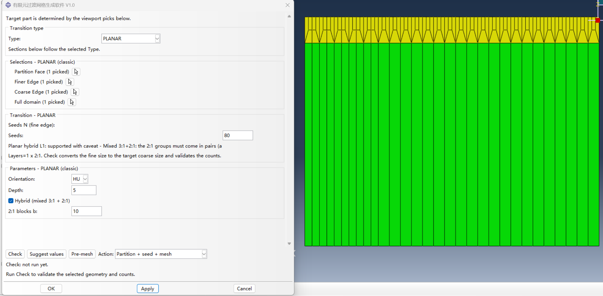<br/>混合 2:1 + 3:1：参数（应用前）</td>
<td align="center" width="50%">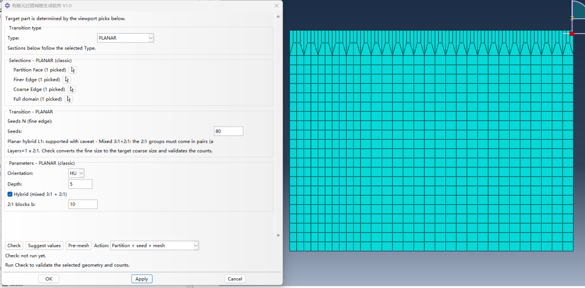<br/>混合过渡结果</td>
</tr>
</table>

### 4.2 PLANAR_ANNULAR 平面圆环

适用几何：平面同心圆环带，细端可以在内侧，也可以在外侧。

#### 4.2.1 前置几何

先用两个同心圆把圆盘切成三段独立面域：

```text
细侧规则环  |  过渡环带  |  粗侧规则环
```

不支持在未切分的整块圆盘面上直接划分。细端在外侧时，按实际几何拾取内外圈即可，插件会根据拾取圆弧的半径自动判断细粗方向。

#### 4.2.2 拾取项

| 拾取项 | 是否必选 | 说明 |
| --- | --- | --- |
| `Transition region` | 必选，单选 | 目标过渡环面 |
| `Fine loop` | 必选，多选 | 细端圆弧的全部边段 |
| `Coarse loop` | 必选，多选 | 粗端圆弧的全部边段 |
| `Full domain` | 可选，多选 | 内外两侧相连的规则环面，用于全域划分 |

#### 4.2.3 参数与规则

- `Seeds` 是一整圈的段数，不是单段圆弧的段数；
- 细侧段数必须满足整除校验，并且全周模板周期数不得少于 3；
- 如果模型有扇区等分切分，粗侧段数还必须能被扇区数整除；
- 细圈和粗圈的原生几何顶点角度必须落在角网格剖分线上，角向偏差超过 0.001° 时插件会提示调整 `N` 或修正分割线；
- 拾取 `Full domain` 后，插件按半径把面域归类为细侧规则环、过渡带和粗侧规则环，规则环按弧长比例分配种子，保证公共圆周上的节点一一对应。

#### 4.2.4 操作与结果

1. 完成同心圆切分，确保过渡环带可以结构化划分；
2. `Type` 选择 `PLANAR_ANNULAR`；
3. 依次拾取 `Transition region`、`Fine loop`、`Coarse loop`，按需拾取 `Full domain`；
4. 填写 `Seeds`、`Layers`、`Ratio`；
5. 依次执行 `Check`、`Pre-mesh`，确认后 `Apply`。

<table>
<tr>
<td align="center" width="50%">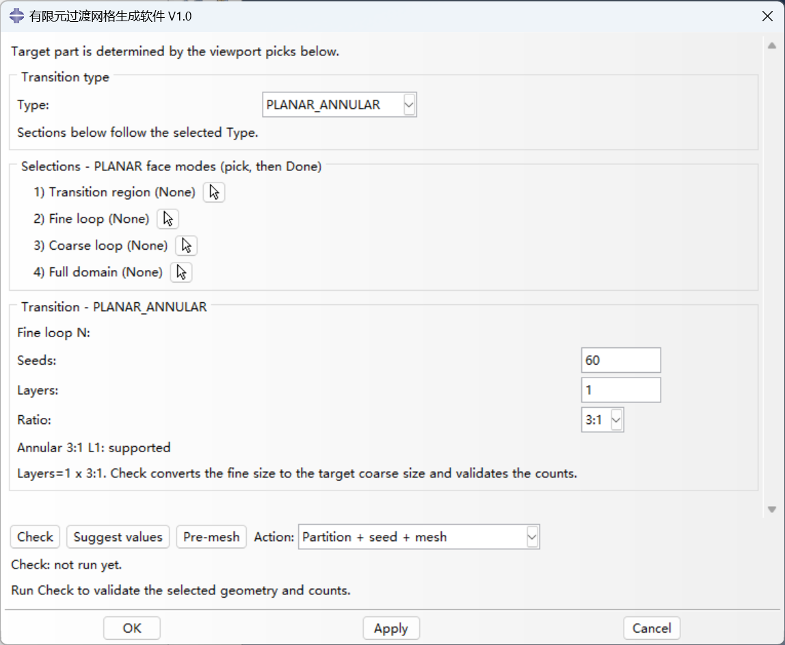<br/>PLANAR_ANNULAR 模式对话框</td>
<td align="center" width="50%">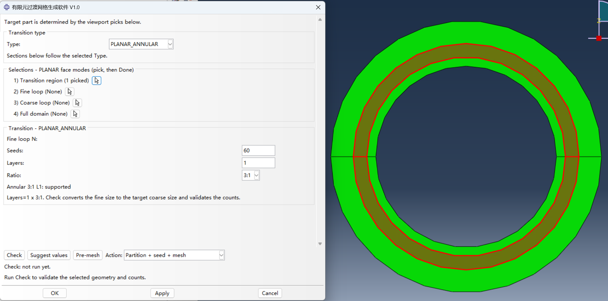<br/>拾取过渡环面</td>
</tr>
<tr>
<td align="center" width="50%">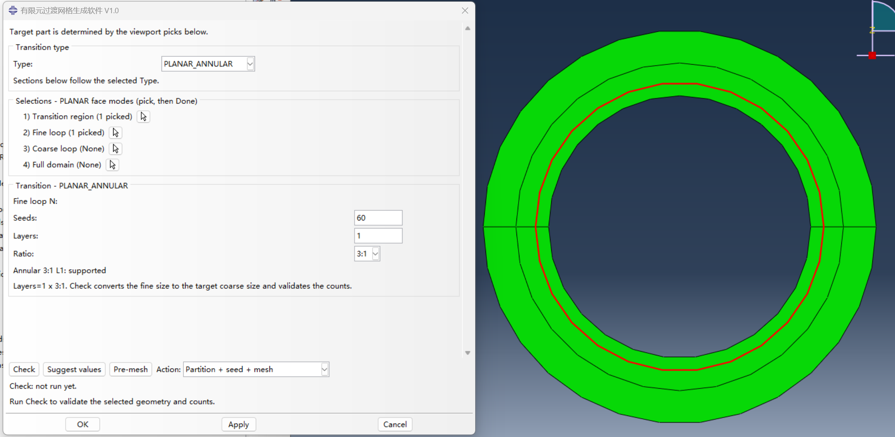<br/>拾取细圈</td>
<td align="center" width="50%">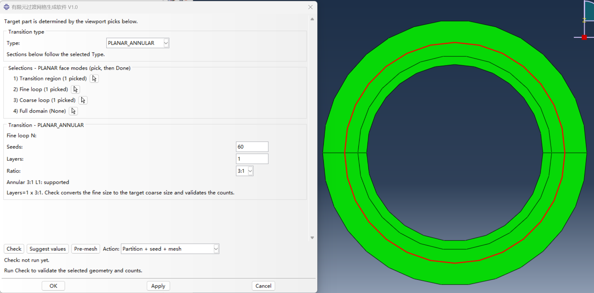<br/>拾取粗圈</td>
</tr>
<tr>
<td align="center" width="50%">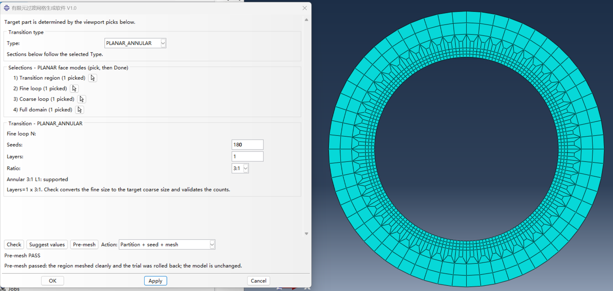<br/>圆环 3:1 过渡结果</td>
<td align="center" width="50%">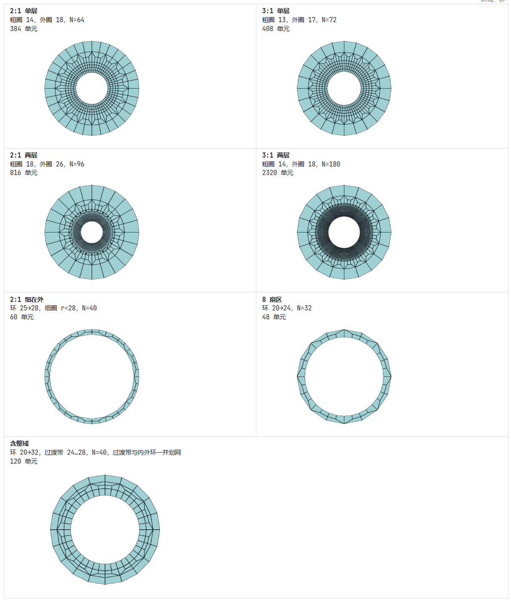<br/>其他圆环案例：单层、多层、细内、细外、扇区、全域</td>
</tr>
</table>

### 4.3 PLANAR_QUAD_FOUR 矩形四周

适用几何：围绕矩形内框向外生成一整圈过渡网格。拓扑规则固定为细网格在内、粗网格在外。

#### 4.3.1 拾取项

| 拾取项 | 是否必选 | 说明 |
| --- | --- | --- |
| `Transition region` | 必选，单选 | 包含内框到外框的整圈过渡面 |
| `Fine loop` | 必选，多选 | 内框四条连续边，必须构成闭合矩形环 |
| `Coarse loop` | 可选，多选 | 外框环；留空时由插件按规则自动推算 |
| `Full domain` | 可选，多选 | 中心区和外围规则面，用于全域划分 |

`Fine loop` 会校验对边等长、四角为直角，支持任意旋转角度的倾斜矩形。若把细网格误拾取在外侧，插件会拦截执行并提示交换内外环。

#### 4.3.2 参数与拓扑

- `Nx` 是主向细段数，`Ny` 是正交向细段数；`Ny=0` 表示两个方向采用相同的细段数；
- `Nx` 与 `Ny` 分别校验整除性，一个方向合法不代表另一个方向也合法；
- 2:1 单层：粗侧段数等于 `Nx/2 + 2`，其中加 2 是两个角部的跨向贡献，外框每侧扩展两个粗单元宽；
- 3:1 单层：粗侧段数等于 `Nx/3 + 2`；
- 2:1 支持多层级联。非首级过渡前，插件会先在外围补一圈规则正交环，保证下一级细段数满足 4 的倍数，补环不会改变已经生成的细侧种子；
- 3:1 在几何上可以构造，但过渡行单元长宽比约为 3，网格质量不如 2:1。需要规整网格时优先用 2:1；使用 3:1 多层时，`Check` 会给出质量提示。

`Coarse loop` 建议留空。插件会按过渡比自动推算外框尺寸，并在摘要中回显，省去手工计算扩边距离。

#### 4.3.3 操作与结果

1. 画出矩形内框，必要时预先切出整圈过渡面；
2. `Type` 选择 `PLANAR_QUAD_FOUR`；
3. 拾取 `Transition region` 和 `Fine loop`，按需拾取 `Coarse loop` 与 `Full domain`；
4. 填写 `Nx`、`Ny`、`Layers`、`Ratio`；
5. 依次执行 `Check`、`Pre-mesh`，确认后 `Apply`。

<table>
<tr>
<td align="center" width="50%">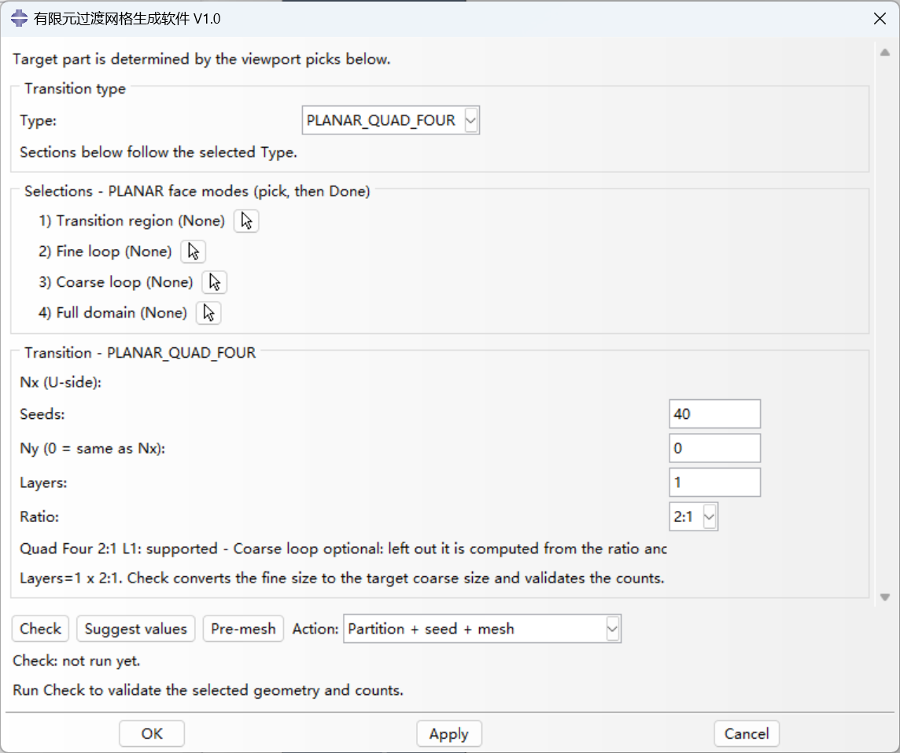<br/>PLANAR_QUAD_FOUR 模式对话框</td>
<td align="center" width="50%">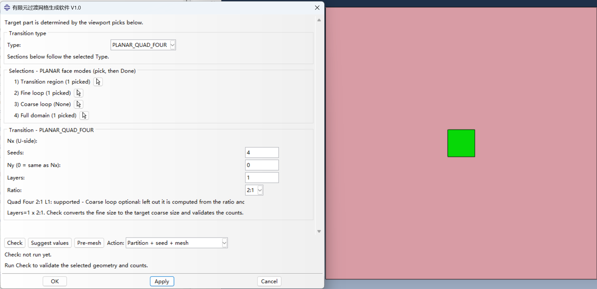<br/>拾取内框与过渡面</td>
</tr>
<tr>
<td align="center" width="50%">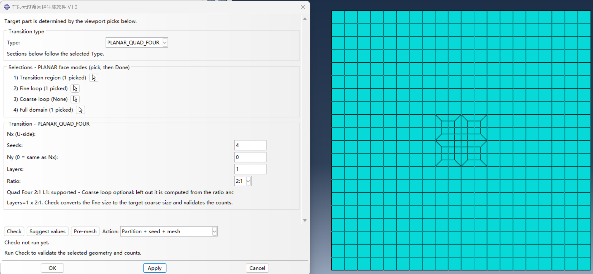<br/>方形内框 2:1 过渡结果</td>
<td align="center" width="50%">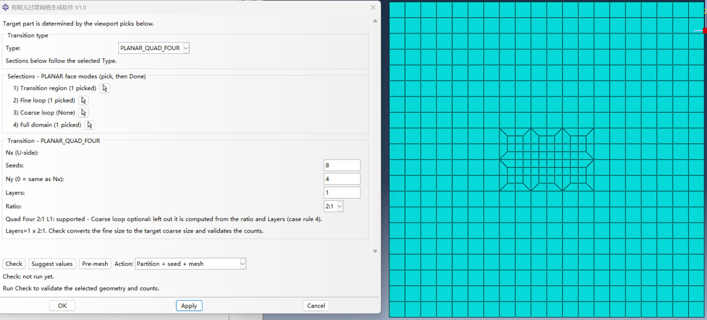<br/>矩形内框 2:1 过渡结果（Ny 单独设置）</td>
</tr>
<tr>
<td align="center" width="50%">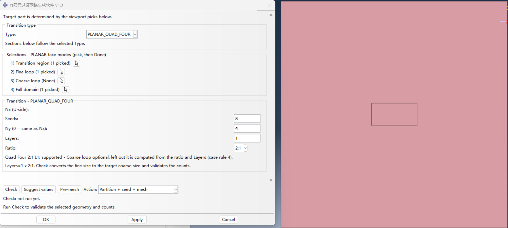<br/>矩形内框拾取</td>
<td align="center" width="50%">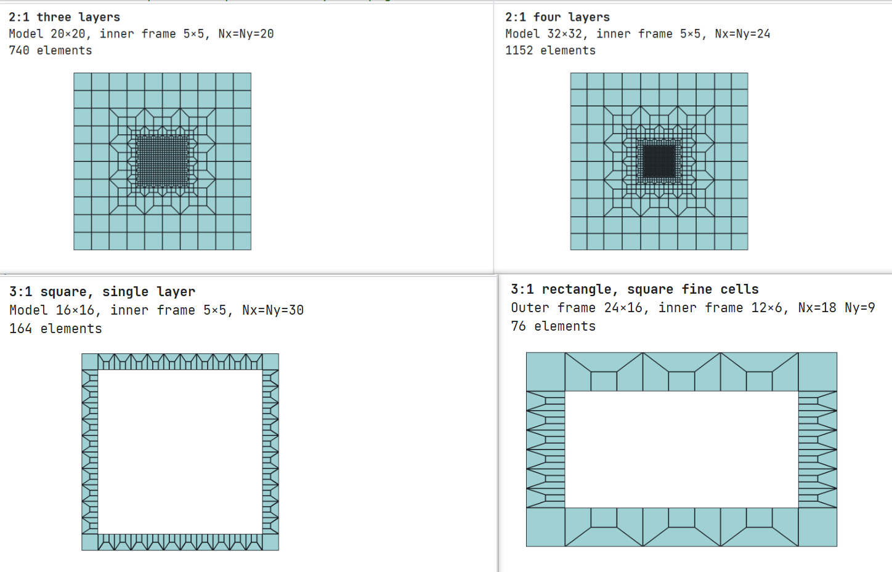<br/>其他案例：2:1 三层、四层，3:1 单层，矩形 3:1</td>
</tr>
</table>

### 4.4 ANNULAR_RADIAL 圆筒径向

适用几何：三维厚壁圆筒的环形端面，沿壁厚方向从细网格过渡到粗网格。细端和粗端必须位于同一个端面上，并且保持同心。

#### 4.4.1 拾取项

| 拾取项 | 是否必选 | 说明 |
| --- | --- | --- |
| `Region Faces` | 必选，多选 | 端面上的过渡带面 |
| `Fine Edge Loop` | 必选，多选 | 细端圆弧边，细端可以在内侧或外侧 |
| `Coarse Edge Loop` | 必选，多选 | 粗端圆弧边，插件校验共面性和同心性 |
| `Target Cells` | 必选，多选 | 待划网格的实体过渡带 Cell |
| `Sweep Path Edges` | 可选，多选 | 三维扫掠路径边，必须属于目标 Cell；留空时由插件自动推导 |

#### 4.4.2 前置条件

- 预先在几何中切出独立的过渡带实体 Cell；
- 在 Mesh 模块为该 Cell 指定扫掠技术，建议同时指定扫掠路径；
- 端面上必须有一条横贯环带的径向直边，通常由管壁的扇区切分线提供，用于象限模板的角度相位对齐。缺少这条边时，插件会提示先完成扇区切分；
- 多层径向过渡要求按中间过渡半径预先切分实体 Cell，使每个 Cell 的径向跨度刚好覆盖一层过渡带。插件会按内外半径和层数推算各级理论半径并逐级校验。

#### 4.4.3 参数与规则

- `Seeds` 是细端圆周的总段数；
- 模板以 90° 象限为整体对齐，模板周期必须能整除 90°；
- 2:1 时，`N` 取 16 的倍数可以满足该条件；
- 3:1 时，`N` 取 12 的倍数可以满足该条件；
- 不满足时，状态行会给出邻近的合法段数，也可以直接点 `Suggest values`。

勾选 `Auto-adapt regular regions (seed + mesh)` 后，插件在完成过渡带之余，会自动为相邻的内外规则区匹配布种并生成网格。取消勾选则只处理过渡带本身。

#### 4.4.4 操作与结果

1. 完成圆筒端面的过渡带 Cell 切分，设置扫掠；
2. `Type` 选择 `ANNULAR_RADIAL`；
3. 依次拾取 `Region Faces`、`Fine Edge Loop`、`Coarse Edge Loop`、`Target Cells`，按需拾取 `Sweep Path Edges`；
4. 填写 `Seeds`、`Layers`、`Ratio`，按需勾选 `Auto-adapt`；
5. 依次执行 `Check`、`Pre-mesh`，确认后 `Apply`。

<table>
<tr>
<td align="center" width="50%">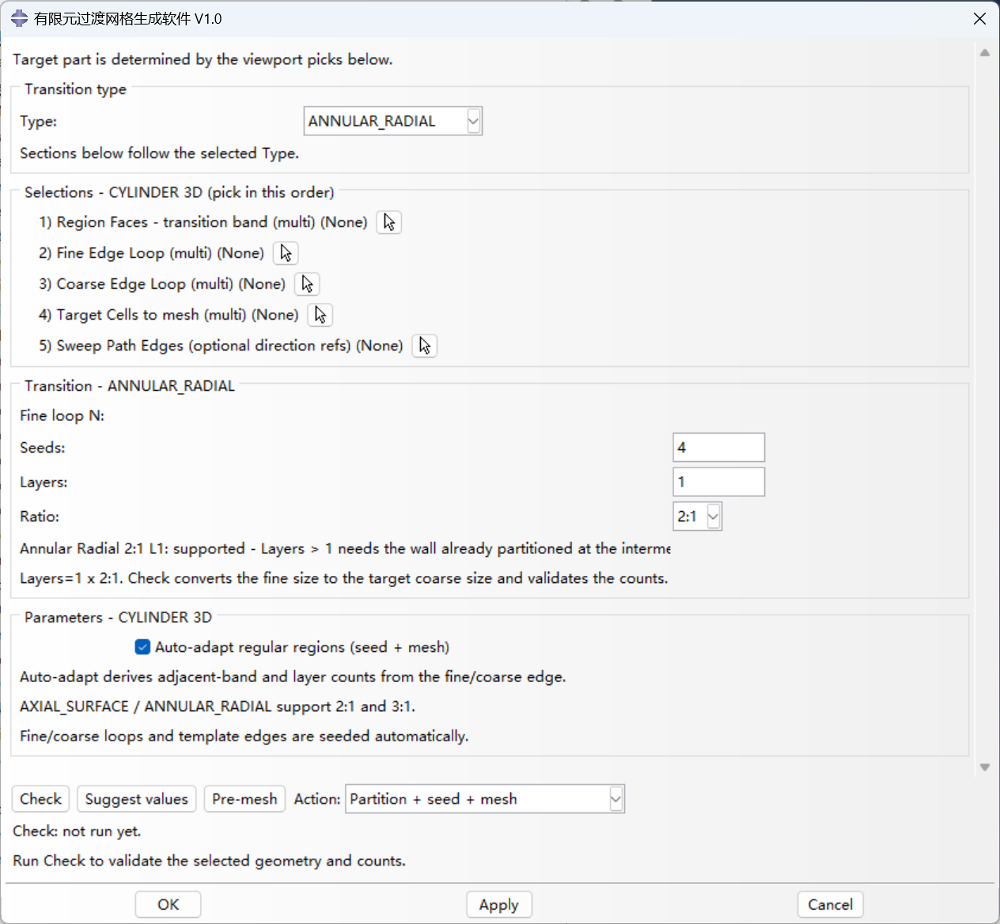<br/>ANNULAR_RADIAL 模式对话框</td>
<td align="center" width="50%">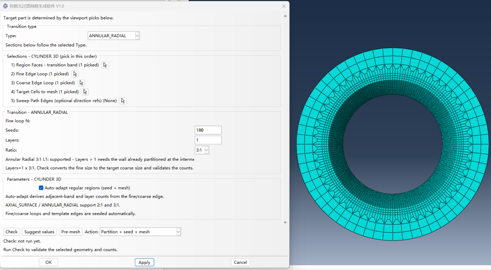<br/>圆筒端面径向 3:1 过渡结果</td>
</tr>
<tr>
<td align="center" colspan="2">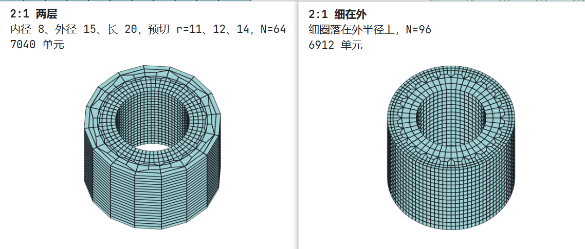<br/>圆筒径向 2:1 案例：两层过渡、细圈在外</td>
</tr>
</table>

### 4.5 AXIAL_SURFACE 圆筒轴向

适用几何：圆柱形实体或壳体的筒身表面，沿轴线方向从细网格圈过渡到粗网格圈。

#### 4.5.1 拾取项

| 拾取项 | 是否必选 | 说明 |
| --- | --- | --- |
| `Region Faces` | 必选，多选 | 筒身圆柱面上的过渡带面 |
| `Fine Edge Loop` | 必选，多选 | 细端截面的圆周环边 |
| `Coarse Edge Loop` | 必选，多选 | 粗端截面的圆周环边 |
| `Target Cells` | 必选，多选 | 待划网格的过渡带实体 Cell |
| `Sweep Path Edges` | 可选，多选 | 沿筒身轴线的母线边，必须属于目标 Cell；留空时自动推导 |

#### 4.5.2 几何要求

- 细圈和粗圈位于同一圆柱面的不同横截面上；
- 插件通过两圈圆心的连线确定圆筒轴线，并校验两个截面是否与轴线垂直；
- 建模时需要沿轴线把圆筒实体切成细网格区、过渡带和粗网格区三段，并保留壁厚方向的扫掠拓扑；
- 轴向切面数量由插件按过渡比自动计算，不需要手动输入；
- 插件会检查轴向切面与既有径向缝的角度适配性。切面与所有既有分割缝完全重合时会判定失败，并提示邻近合法段数；切面分布不均时会给出切分警告。

#### 4.5.3 参数与规则

- `Seeds N (per section)` 是细端截面圆周的单元段数；
- 2:1 时，`N` 需要能被 4 整除，因为每个扇区使用一对 4 细到 2 粗的模板；
- 3:1 时，`N` 需要能被 3 整除；
- 轴向多层不需要手动逐层预切。过渡分界面都是垂直于轴线的横截平面，插件会按各级宽度自动切出中间横截面；
- 勾选 `Auto-adapt regular regions (seed + mesh)` 后，相邻的细区和粗区规则实体也会自动布种并划网。

#### 4.5.4 操作与结果

1. 沿轴线把圆筒切成细区、过渡带和粗区，保留壁厚方向的扫掠拓扑；
2. `Type` 选择 `AXIAL_SURFACE`；
3. 依次拾取 `Region Faces`、`Fine Edge Loop`、`Coarse Edge Loop`、`Target Cells`，按需拾取 `Sweep Path Edges`；
4. 填写 `Seeds`、`Layers`、`Ratio`，按需勾选 `Auto-adapt`；
5. 依次执行 `Check`、`Pre-mesh`，确认后 `Apply`。

<table>
<tr>
<td align="center" width="50%">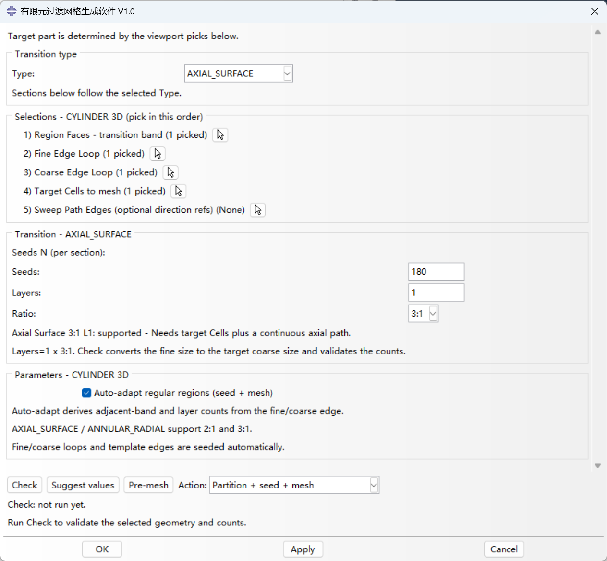<br/>AXIAL_SURFACE 模式对话框</td>
<td align="center" width="50%">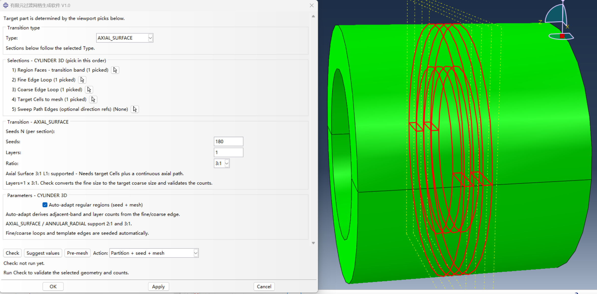<br/>圆筒轴向过渡带拾取与模板</td>
</tr>
<tr>
<td align="center" colspan="2">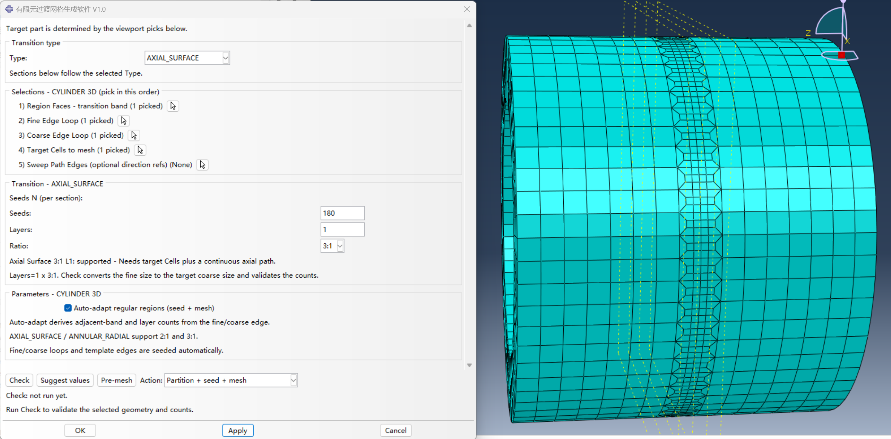<br/>圆筒轴向 3:1 过渡结果</td>
</tr>
</table>

## 5 常见报错与处理

检查状态和报错信息主要通过界面状态行和弹窗反馈。所有操作都受模型事务保护，参数校验不通过或划网失败时，模型会自动回滚到执行前状态。

| 触发条件 | 软件提示 | 处理与修正 |
| --- | --- | --- |
| 单选组选中多个对象或未选 | `requires exactly one face/edge; got N` | 在视口中重新单选目标几何并按 Done 确认 |
| 几何对象跨部件混选 | `Selected entities belong to multiple parts` | 清空当前选择，在同一部件内重新拾取 |
| 模式切换残留或几何失效 | `Command dispatch failed... Repick active geometry` | 清空残留选择，重新拾取当前模式的目标几何 |
| 缺少必选边圈或实体 | `needs fine and coarse edge loops / Select target cells` | 补齐细粗圈等必选要素，三维模式补选目标 Cell |
| 细侧段数不满足整除要求 | `Need divisible by X. near A/B` | 点击 `Suggest values` 自动回填邻近合法值 |
| 混合参数比例冲突 | `2:1 blocks b must be even / a not integer` | 把 `b` 改为偶数，调整 `N` 使 `N-2b` 为 3 的倍数 |
| 过渡深度超出面域范围 | `Transition depth must be positive / reaches beyond width` | 改小 `Depth`，或显式拾取粗边以实测距离为准 |
| 经典平面朝向设置不当 | `Orientation direction is not in face plane` | 改选垂直于细边且位于面内的过渡方向 |
| 平面圆环相位偏移过大 | `Vertex angle not on angular grid (dev > 0.001 deg)` | 按提示微调段数 `N`，或修正几何的径向分割线 |
| 矩形四周细外粗内 | `Inward transition not supported` | 交换内外框拾取；圆环结构改用 `PLANAR_ANNULAR` |
| 矩形外框尺寸不符拓扑 | `Rule 4 not met: need half-sizes...` | 留空外框由插件自动推导，或按提示尺寸重切 |
| 圆筒径向缺少对齐直边 | `No radial edge found in the band for phase alignment` | 在几何端面上预先完成管壁的扇区经向切分 |
| 圆筒多层缺少中间切分 | `Stages > 1: target Cells must already be partitioned...` | 按中间半径预先切分 Cell，或在 Check 弹窗点 Yes 继续 |
| 圆筒轴向切片与既有缝重合 | `Axial slice pattern collides with the existing cuts` | 采用推荐的合法段数，错开既有切分缝 |
| 划分后单元总数为零 | `Generate Mesh produced 0 elements` | 检查过渡控制方式与边界种子约束后重新划分 |
| 网格质量审计未通过 | `Mesh audit failed or incomplete` | 模型已自动回滚，建议增大过渡带宽度或减小层数 |
| 三维实体未指定扫掠 | `Face not attached to solid / sweep path missing` | 在 Mesh 模块为过渡 Cell 指定扫掠方向与路径 |
| 预划网试划拦截 | `Pre-mesh failed (model rolled back)` | 模型已无损回滚，按弹窗中的具体原因修正参数 |
| 模块重复或版本冲突 | `Deployment manifest conflict / version mismatch` | 关闭 Abaqus，清理插件搜索目录中的重复副本 |

## 6 使用范围与限制

- 三维模式（三维平板、圆筒径向、圆筒轴向）要求过渡带位于预先切分好的实体 Cell 上，并且该 Cell 具备可用的扫掠或结构化条件；
- 圆筒径向多层过渡必须按中间半径预先切分实体 Cell；圆筒轴向多层过渡由插件自动切分中间截面；
- `PLANAR_QUAD_FOUR` 只支持细网格在内、粗网格在外的拓扑，反向拾取会被拦截；
- 圆环模式不支持未切分的整块圆盘面，必须先用同心圆切出过渡环带；
- `Hybrid` 混合过渡只支持 `PLANAR`，并且只能单层；
- 圆筒模式适合规则圆柱、空心圆筒和厚壁圆筒端面，不适合任意自由曲面、变半径曲面或复杂开孔曲面；
- 正式执行前应至少通过 `Check`，建议同时通过 `Pre-mesh`；
- 同一个插件搜索目录中只保留一份完整副本。

## 7 联系与支持

### 7.1 联系

- 非商业用途可直接使用；商用、合作或定制请联系 **Z25150070@s.upc.edu.cn**；
- 问题反馈：欢迎提交 [GitHub Issue](https://github.com/IY724/TransitionMesh/issues)，或发送邮件；
- 本项目借助 AI 辅助编程（vibecoding）完成。

### 7.2 Buy Me a Coffee

课题组不报销 token，插件的开发和维护靠自费研究完成。如果你觉得这个插件好用，欢迎请我喝杯咖啡，支持后续更新。

<table>
<tr>
<td align="center" width="50%"><br/>微信支付</td>
<td align="center" width="50%"><br/>支付宝</td>
</tr>
</table>
